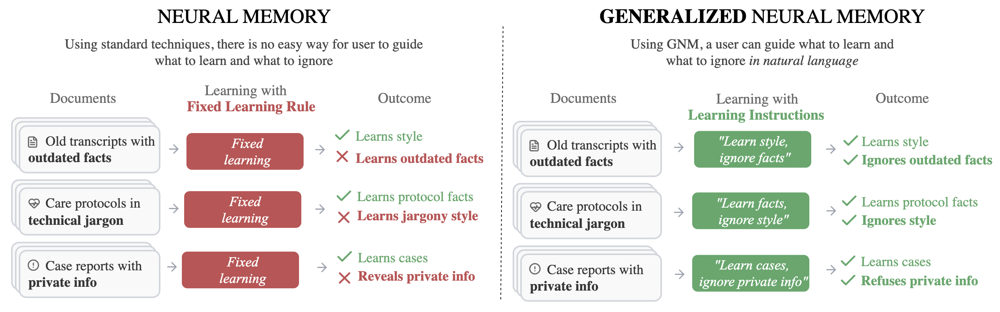

# Generalized Neural Memory

Official implementation of **"Tell Me What To Learn: Generalizing Neural Memory to be Controllable in Natural Language"** (NeurIPS 2026).

*Max S. Bennett, Thomas P. Zollo, Richard Zemel — Columbia University*

[](https://arxiv.org/abs/2602.23201)
[](https://huggingface.co/collections/maxbennett/generalized-neural-memory-neurips-2026-6acfd9327bb3b2495289f12c)
[](https://huggingface.co/maxbennett)
[](https://huggingface.co/datasets/maxbennett/generalized-neural-memory-counterfact)
[](LICENSE)



---

## 1. Installation

```bash
git clone https://github.com/maxbennett/Generalized-Neural-Memory.git
cd Generalized-Neural-Memory

conda create -n gnm python=3.10 -y
conda activate gnm
pip install -r requirements.txt
```

## 2. Download models and data

```bash
python scripts/download_models.py                 # all 7 checkpoints -> models/<name>/model.pth
python scripts/download_models.py --counterfact   # CounterFACT-benchmark models only
python scripts/download_models.py --personamem    # PersonaMem-benchmark models only

python scripts/download_data.py                   # both benchmarks -> data/
python scripts/download_data.py --counterfact     # or one at a time
python scripts/download_data.py --personamem
```

**Models**

| Local path | HF repo | Role |
|---|---|---|
| `models/gnm_counterfact` | [`gnm-counterfact`](https://huggingface.co/maxbennett/generalized-neural-memory-gnm-counterfact) | **GNM** (CounterFACT, all instruction types) |
| `models/gnm_counterfact_ablation` | [`gnm-counterfact-ablation`](https://huggingface.co/maxbennett/generalized-neural-memory-gnm-counterfact-ablation) | GNM ablation (no gradients through memory write) |
| `models/icl_ft_counterfact` | [`iclft-counterfact`](https://huggingface.co/maxbennett/generalized-neural-memory-iclft-counterfact) | ICL-FT baseline (CounterFACT) |
| `models/rag_ft_counterfact` | [`ragft-counterfact`](https://huggingface.co/maxbennett/generalized-neural-memory-ragft-counterfact) | RAG-FT baseline (CounterFACT) |
| `models/gnm_personamem` | [`gnm-personamem`](https://huggingface.co/maxbennett/generalized-neural-memory-gnm-personamem) | **GNM** (PersonaMem) |
| `models/gnm_personamem_ablation` | [`gnm-personamem-ablation`](https://huggingface.co/maxbennett/generalized-neural-memory-gnm-personamem-ablation) | GNM ablation (PersonaMem) |
| `models/icl_ft_personamem` | [`iclft-personamem`](https://huggingface.co/maxbennett/generalized-neural-memory-iclft-personamem) | ICL-FT baseline (PersonaMem) |

**Datasets**

| Local path | HF repo | Contents |
|---|---|---|
| `data/counterfact/` | [`generalized-neural-memory-counterfact`](https://huggingface.co/datasets/maxbennett/generalized-neural-memory-counterfact) | train / val-id / test-ood document streams + long-horizon streams |
| `data/personamem/` | [`generalized-neural-memory-personamem`](https://huggingface.co/datasets/maxbennett/generalized-neural-memory-personamem) | training corpora, Val-ID, Val-OOD, appendix eval variants |

The split-by-split layout is in [Section 7](#7-repository-structure). Untrained baselines (MemoryLLM, Llama-3, Qwen3-14B, Gemma3-12B, HippoRAG, M+) download automatically from their public HF repos at eval time.

## 3. Reproduce the main results

### Table 1 — CounterFACT short-horizon results

Runs every system in `evals/counterfact/params_short_horizon.yaml` over the three test-ood document streams (sequence length 10, full lower-triangular probing):

```bash
cd evals/counterfact
scripts/run.sh                                  # all Table-1 systems (edit params_short_horizon.yaml to subset)
scripts/run_memoryagent_short_horizon.sh        # MemoryAgent (write-time LLM filter) baselines
python scripts/assemble_memoryagent_table.py    # assemble the comparison table
```

Per-run outputs land in `results/<run_key>/summary.json`; the paper's runs are checked in under `evals/counterfact/paper_results/short_horizon/`.

### Table 2 — PersonaMem short-horizon results

40 episodes of sequence length 10 drawn from Val-OOD (`data/personamem/val_ood.json`), sharded over 6 GPUs, then merged:

```bash
# GNM
evals/personamem/scripts/run_personamem_eval.sh \
  memoryllm_chat models/gnm_personamem/model.pth \
  evals/personamem/results/personamem_gnm
python evals/personamem/scripts/merge_personamem_eval.py \
  --shards-dir evals/personamem/results/personamem_gnm/_shards \
  --out-dir evals/personamem/results/short_horizon/gnm

# GNM ablation: same two commands with models/gnm_personamem_ablation/model.pth
# ICL-FT uses the ICL harness:
python evals/personamem/scripts/eval_icl_pref.py \
  --eval-path data/personamem/val_ood.json \
  --model llama3_8b_instruct_personamem \
  --model-state-dict-path models/icl_ft_personamem/model.pth \
  --save-root evals/personamem/results/personamem_icl_ft \
  --seq-len 10 --n-rollouts 40 --baseline-source memoryllm
```

The paper's summaries are checked in under `evals/personamem/paper_results/short_horizon/` (raw per-probe traces are reproducible by re-running the commands above, or available from the authors).

### Figures 3 and 4 — long-horizon results

Retention probes with hundreds of documents between write and query. GNM is served through the **long-horizon memory stack**: the same trained GNM weights in an M+ shell (`src/modeling_mplus.py`) with zero-parameter cosine block retrieval (`src/gnm_mplus_retrieval.py`, registry key `gnm_long_horizon`).

```bash
# CounterFACT (Fig. 3): probe runners write evals/counterfact/results/long_horizon/
scripts/final_eval_lanes.sh <gpu-lane>     # facts, per test-ood stream
scripts/fig3_queue_runner.sh               # MemoryAgent + refusal + format lanes
python scripts/make_fig3_retention.py      # renders plots/fig3_counterfact_retention.{png,pdf}

# PersonaMem (Fig. 4)
python evals/personamem/scripts/retention_probe_personamem.py --help
python evals/personamem/scripts/make_fig4_retention.py
```

`make_fig3_retention.py` works directly from the records checked into `paper_results/long_horizon/` — no GPU needed. Figure 4's per-probe traces are not checked in (they are large); re-run the probe to regenerate them, and the paper's rendered figure ships in `plots/`.

### Figure 5 — compute cost

```bash
CUDA_VISIBLE_DEVICES=0 python scripts/profile_costs.py counterfact
CUDA_VISIBLE_DEVICES=0 python scripts/profile_costs.py personamem
python scripts/make_fig5_compute_cost.py
```

### Figure 6 and ablation figures

```bash
python scripts/make_memory_selectivity_chart.py   # Fig 6 target-alignment (reads paper_results/memory_analysis/)
python scripts/make_ablation_bars.py              # appendix ablation bar chart
```

The per-layer alignment records behind Fig 6 are regenerated by
`notebooks/fig6_memory_selectivity_counterfact.ipynb` / `fig6_memory_selectivity_personamem.ipynb`
(inputs `data/analysis/counterfact_memory_analysis.json` and
`data/analysis/personamem_memory_analysis.json`, both shipped).

## 4. Reproduce appendix experiments

| Experiment | Commands |
|---|---|
| Compositional generalization | `cd evals/counterfact && scripts/run.sh params_comp_gen_refusals.yaml` (and `params_comp_gen_formats.yaml`); analyze with `notebooks/appendix_compositional_generalization.ipynb` |
| Format generalization | `notebooks/appendix_format_generalization.ipynb` over `evals/counterfact/paper_results/format_generalization/` |
| Implicit learning instructions | build: `data_pipelines/personamem/scripts/build_implicit_eval.py`; run: `evals/personamem/scripts/run_implicit_refs.sh`; summarize: `summarize_implicit_eval.py`, `implicit_preservation_analysis.py` |
| Inferred learning instructions | pipeline: `data_pipelines/personamem/scripts/infer_learning_instructions.py`; run: `evals/personamem/scripts/run_inferred_evals.sh`; table: `inferred_table.py` |
| Seed robustness | `train/personamem/scripts/run_seed_robustness.sh 43 44 0 1 2`; table: `evals/personamem/scripts/seed_robustness_table.py` |
| Memory heatmaps | `notebooks/appendix_counterfact_heatmaps.ipynb`; layer importance: `notebooks/appendix_layer_importance.ipynb`; selectivity inputs: `notebooks/fig6_memory_selectivity_{counterfact,personamem}.ipynb` |

## 5. Training

### CounterFACT benchmark

```bash
cd train/counterfact
scripts/run.sh params_gnm.yaml            # GNM (also: params_icl_ft / params_rag_ft / params_gnm_ablation)
```

### PersonaMem benchmark

```bash
# from the repo root
torchrun --standalone --nnodes=1 --nproc_per_node=4 \
  train/personamem/scripts/train_personamem.py \
  --params train/personamem/params_gnm.yaml \
  --save-dir saved_models/gnm_personamem
# params_icl_ft.yaml -> ICL-FT; params_gnm_ablation.yaml -> frozen-memory ablation
```

Training uses 4×A100-80GB (DDP). Early stopping keys on each benchmark's val-id split only; the OOD split is monitored per epoch but never used for model selection. Checkpoints are written as `<run_name>_best.pth` / `<run_name>_recent.pth`.

## 6. Benchmark regeneration

The released datasets are canonical (`scripts/download_data.py`); to regenerate from scratch:

1. **CounterFACT benchmark** — `data_pipelines/counterfact_1_categorize/run.sh` (categorize the raw CounterFACT dump), copy its output to `data/counterfact_with_categories/`, then `data_pipelines/counterfact_2_generate_documents/run.sh` (format, hold-out swap, multi-fact document streams).
2. **PersonaMem benchmark** — `data_pipelines/personamem/scripts/`, in order: `build_personamem.py` → `build_multichoice.py` → `generate_merged_documents.py` → `build_all_probes_datasets.py` (writes `data/personamem/train_icl/` + `val_ood.json`); `precompute_*_baseline_letters.py` fill the baseline-letter caches.

## 7. Repository structure

```
.
├── src/                        core library
│   ├── gnm.py                    model wrappers + registry (every system in the paper)
│   ├── modeling_memoryllm.py     MemoryLLM architecture (the trained GNM weights)
│   ├── modeling_mplus.py         M+ shell used for long-horizon serving
│   ├── gnm_mplus_retrieval.py    zero-parameter block retrieval (`gnm_long_horizon`)
│   ├── instructions.py           learning-instruction templates, format/refusal scoring
│   ├── gnm_data.py               CounterFACT datasets + collation
│   ├── preference_data.py        PersonaMem dataset
│   └── memoryllm_train.py        CounterFACT training loop
├── train/
│   ├── counterfact/              one params file per model + scripts/run.sh
│   └── personamem/               one params file per model and seed + scripts/
├── evals/
│   ├── counterfact/              Table 1, Fig. 3, MemoryAgent, compositional + format generalization
│   │   ├── params_*.yaml           one params file per protocol
│   │   ├── scripts/                eval.py, run.sh, MemoryAgent runner + table assembler
│   │   └── paper_results/          the paper's runs (reruns write to results/ instead)
│   └── personamem/               Table 2, Fig. 4, seed robustness, implicit / inferred instructions
│       ├── scripts/                eval, merge, retention-probe and table scripts
│       └── paper_results/          the paper's runs
├── scripts/                    downloads, figure generators, long-horizon probes, cost profiler
├── data_pipelines/             benchmark construction (CounterFACT stages 1–2, PersonaMem)
├── models/                     checkpoint skeleton, filled by scripts/download_models.py
├── data/                       benchmark skeleton, filled by scripts/download_data.py (layout below) + tracked caches and Fig. 6 inputs
├── notebooks/                  appendix analyses (outputs stripped)
├── plots/                      the paper's figures as rendered by this repo
└── assets/                     README figures, prompt-template variants
```

**Data layout** (`scripts/download_data.py`), using the paper's split names:

| Path | Split | Contents |
|---|---|---|
| `data/counterfact/train_0-4.json` | train | five training buckets |
| `data/counterfact/val_id.json` | val-id | new facts, seen categories — early stopping only |
| `data/counterfact/test_ood_0-2.json` | test-ood | held-out categories and formats — the three Table 1 / Fig. 3 streams |
| `data/counterfact/test_ood_1000doc_0-2.json` | test-ood | 1,000-document streams for the long-horizon supplement |
| `data/personamem/train_{gnm,icl,gnm_seed_robustness}/train_0-4.json` | train | each released model's training corpus |
| `data/personamem/train_*/val_id.json` | Val-ID | unseen preferences, seen target topics — early stopping only |
| `data/personamem/val_ood.json` | Val-OOD | held-out target topics — **the** evaluation file for every reported PersonaMem number |
| `data/personamem/implicit_eval/`, `inferred_eval/` | Val-OOD | same examples with implicit / LLM-authored learning instructions (appendix) |
| `data/baseline_letter_caches/`, `data/analysis/` | — | tracked: per-model no-memory baseline picks; Fig. 6 inputs |

## 8. Acknowledgments

This project builds on
[MemoryLLM](https://github.com/wangyu-ustc/MemoryLLM) (Wang et al., ICML 2024) — `src/modeling_memoryllm.py` is a modified fork — and
[M+](https://github.com/wangyu-ustc/MPlus) (Wang et al., 2025) — `src/modeling_mplus.py` is vendored as the long-horizon serving shell.
The MemoryAgent baselines use Llama-3-8B-Instruct as a write-time filter; the HippoRAG baseline follows Gutiérrez et al. (NeurIPS 2024).

```bibtex
@inproceedings{bennett2026tellme,
  title     = {Tell Me What To Learn: Generalizing Neural Memory to be Controllable in Natural Language},
  author    = {Bennett, Max S. and Zollo, Thomas P. and Zemel, Richard},
  booktitle = {Advances in Neural Information Processing Systems (NeurIPS)},
  year      = {2026},
  url       = {https://arxiv.org/abs/2602.23201}
}
```

## License

MIT — see [LICENSE](LICENSE) (includes attributions for the MemoryLLM / M+ derived files).
